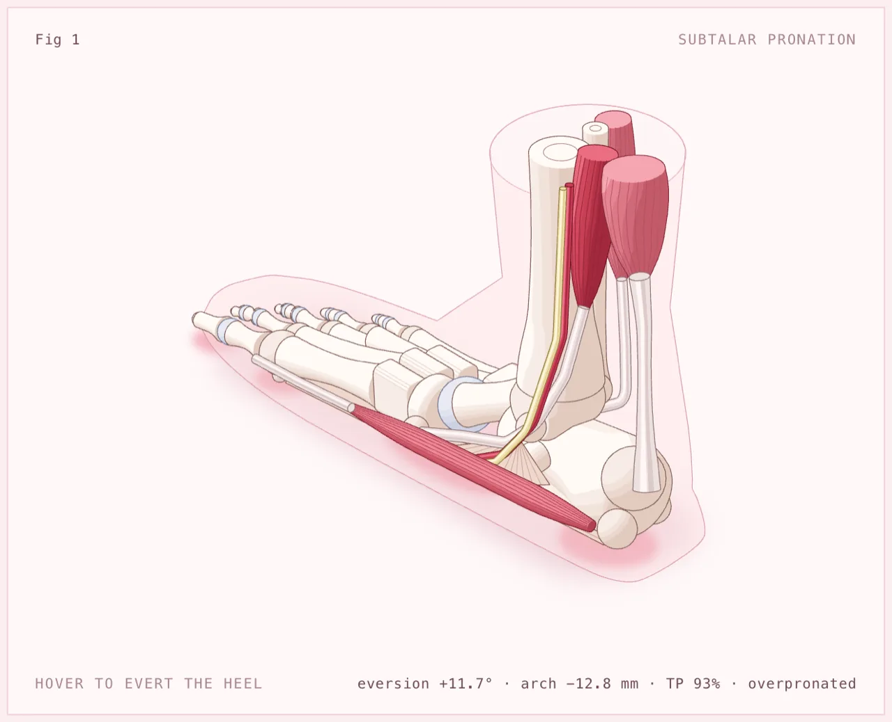
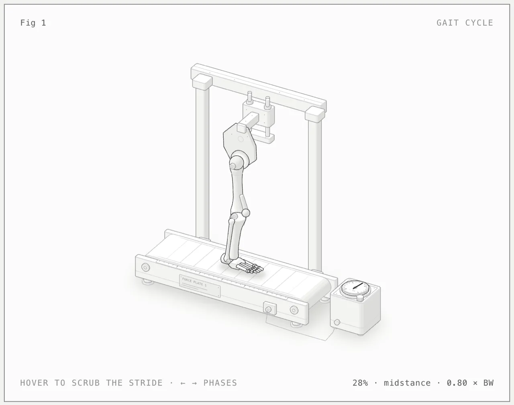
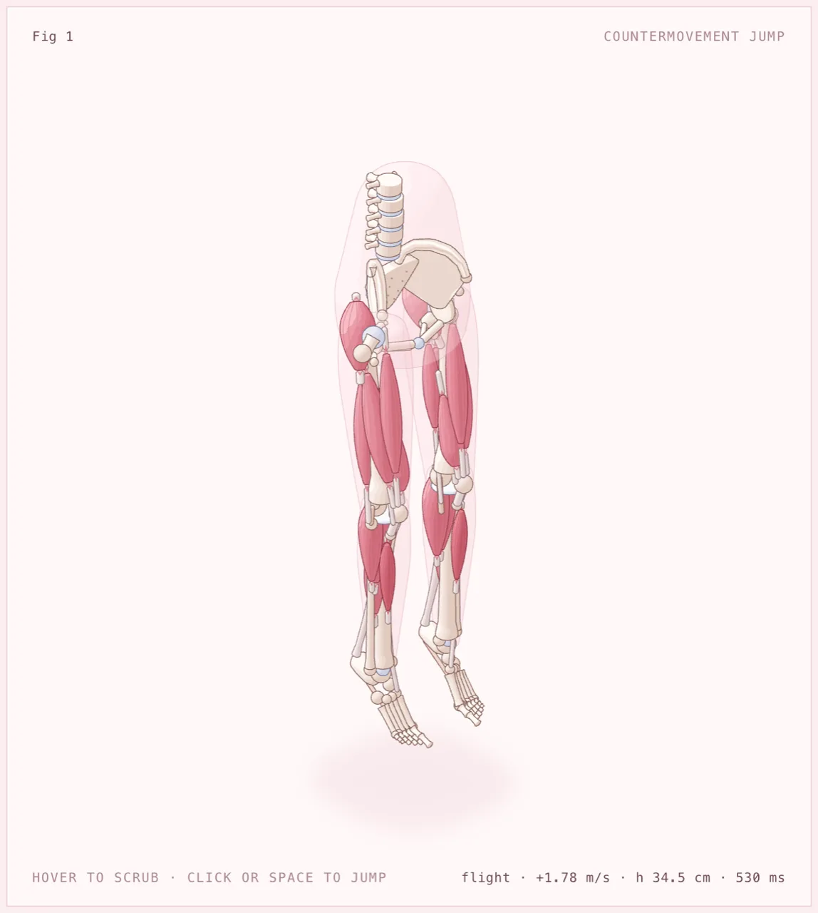
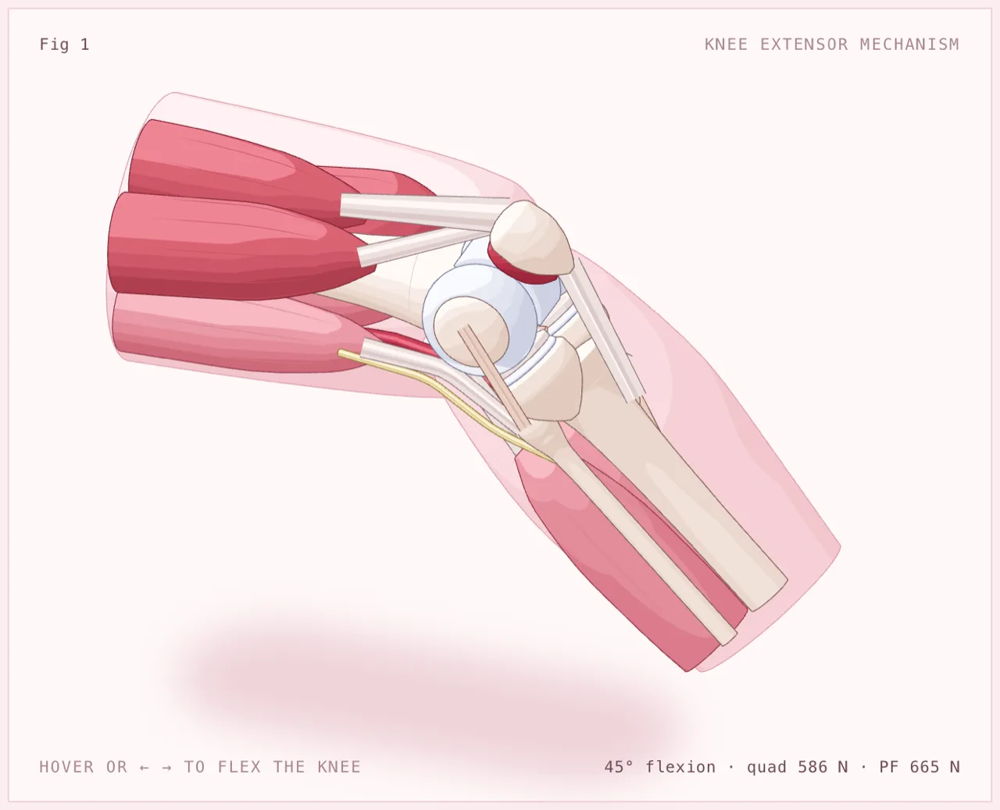
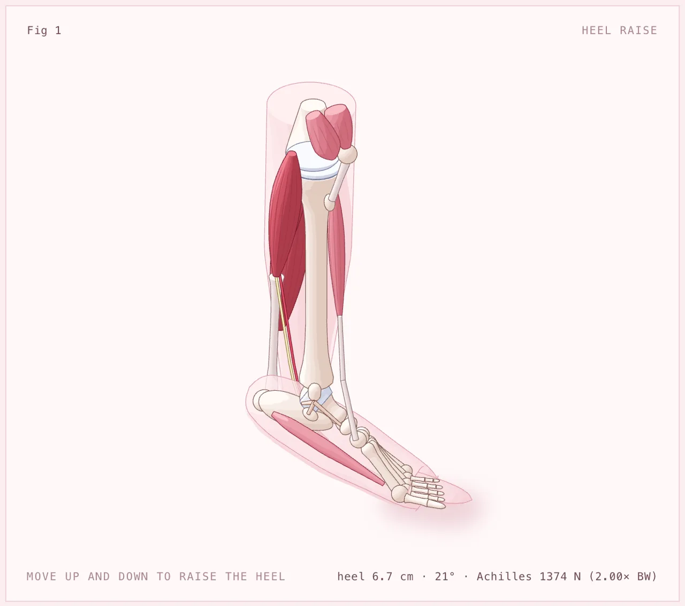
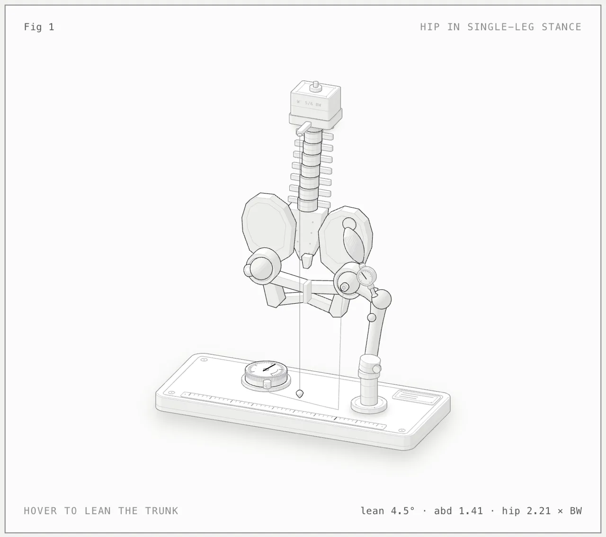

<h1 align="center">Human Anatomy</h1>

<p align="center"><b>A Claude skill that explains human anatomy and biomechanics by building it as a real, working object.</b><br>Also runs in Antigravity, OpenCode, Codex and MiniMax Code.<br>Crafted, interactive isometric figures with many small precise parts, in SVG, WebGL and 3D.</p>

<p align="center">
  <a href="https://code.claude.com/docs/en/skills"></a>
  <a href="https://agentskills.io"></a>
  <a href="LICENSE"></a>
  <a href="#requirements"></a>
  <a href="#requirements"></a>
  <a href="https://github.com/lazarjov/human-anatomy/actions/workflows/ci.yml"></a>
</p>

<p align="center">
  <a href="https://github.com/lazarjov/human-anatomy/archive/refs/heads/main.zip"></a>
  &nbsp;
  <a href="#install"></a>
</p>

<p align="center">
  <a href="#quick-start">Quick start</a> ·
  <a href="#gallery">Gallery</a> ·
  <a href="#what-it-makes">What it makes</a> ·
  <a href="#install">Install</a> ·
  <a href="#usage">Usage</a> ·
  <a href="#examples">Examples</a> ·
  <a href="#how-it-works">How it works</a> ·
  <a href="#limits">Limits</a>
</p>

<p align="center">
  
</p>

<p align="center"><sub><code>examples/foot-pronation</code>, light theme, overpronated. Each tissue has its own colour, and each muscle deepens from rose to red as the model says it works harder.</sub></p>

---

Ask Claude for a figure that explains how the body moves, and Anatomy builds it as a pink anatomical teaching model, the kind you would find on a lecturer's desk, that moves the way the body does. Why the hip carries nearly three times body weight when you stand on one leg becomes a pelvis balanced on one femoral head, with the gluteus medius reddening as it holds the pelvis level. How high you jump becomes a lower-body model whose glutes, quadriceps and calves fire from hip to ankle and fall quiet in flight.

Claude builds the model out of dozens of small, solid, shaded tissues. Bones carry their real landmarks and cartilage caps. Muscles are fibred bellies on pearly tendons at their true origins and insertions. Ligaments, joint capsules, vessels and nerves sit where they belong, and a faint translucent skin outlines the body segment. Each tissue has its own colour from one shared palette (`kit/tissue.mjs`), and each muscle deepens from rose to red with its activation. Claude puts the model in a framed card with a title, a hint and a live readout, makes it move calmly under the pointer and the keyboard, and checks its own work by zooming in on every joint. Every number and every muscle's colour comes from the same small biomechanics model that moves the bones.

> [!NOTE]
> **This is a fork of [`wheresryan22/anatomy`](https://github.com/wheresryan22/anatomy) focused on human anatomy and physiology.** The kit, the craft rules and the checks are the upstream ones, plus a tissue palette. The original machine examples (the Raptor engine, ripple tank, turning dial and others) are replaced here by six anatomical models: gait, foot pronation, a countermovement jump, the knee extensor mechanism, the ankle as a lever and the hip in single-leg stance. The guides in `references/` still cite the originals for advanced techniques (WebGL, React, the 3D mode); those live upstream.

## Quick start

```sh
npx skills add lazarjov/human-anatomy -g
```

The CLI asks which agents to set up (Claude Code, Antigravity, OpenCode, Codex, MiniMax Code). To skip the question, add `-a claude-code`, `-a antigravity`, `-a opencode`, `-a codex`, or `-a minimax-code`.

Then, in Claude Code:

```text
/anatomy show what happens at the knee in a deep squat, interactive
```

For Antigravity, OpenCode, Codex, or MiniMax Code, target that agent: `-a antigravity`, `-a opencode`, `-a codex`, or `-a minimax-code`. Antigravity, OpenCode and MiniMax Code take the same `/anatomy` command; in Codex, type `$anatomy`.

That's it. No API keys and nothing to `npm install`: the kit uses only Node's built-in modules.

## Gallery

<table>
  <tr>
    <td width="50%"></td>
    <td width="50%"></td>
  </tr>
  <tr>
    <td><sub><b>gait-cycle</b>: one stride in Perry's eight phases. Thirteen muscles redden in typical EMG timing: tibialis anterior at heel strike, the vasti in loading, the calf in terminal stance, the hamstrings in terminal swing. The contact patch grows with the double-hump ground force.</sub></td>
    <td><sub><b>foot-pronation</b>: evert the heel from −6° to +12°. The arch drops past 10 mm, the spring ligament and plantar fascia stretch, tibialis posterior reddens to 95% as it works to hold the arch, and the contact print moves medially.</sub></td>
  </tr>
  <tr>
    <td></td>
    <td></td>
  </tr>
  <tr>
    <td><sub><b>countermovement-jump</b>: impulse–momentum. Braking loads the quadriceps eccentrically, propulsion fires the glutes, then the quadriceps, then the calves, and flight is quiet. Takeoff at 2.60 m/s gives a 34.5 cm jump with 530 ms in the air, then a 3.7 BW landing.</sub></td>
    <td><sub><b>knee-joint</b>: the extensor mechanism. Flex from 0 to 90° against a 10 kg ankle weight. The quadriceps reddens with its force (859 N straight), and the patellar cartilage flushes with patellofemoral force, peaking at 665 N near 45°.</sub></td>
  </tr>
  <tr>
    <td></td>
    <td></td>
  </tr>
  <tr>
    <td><sub><b>calf-raise</b>: the ankle as a second-class lever. The triceps surae pulls 2.8 × BW through the Achilles tendon at heel-off and pales to 1.7 × BW at 30°, as the forefoot lever shortens.</sub></td>
    <td><sub><b>hip-abductors</b>: Pauwels' single-leg stance. The gluteus medius carries 1.75 × BW and the hip 2.55 × BW. Lean the trunk 10° over the stance hip and both fall, to 1.0 and 1.8 × BW, as the muscle pales.</sub></td>
  </tr>
</table>

Every screenshot is the light theme of a page in [`examples/`](examples), captured with the skill's own [`scripts/capture.mjs`](scripts/capture.mjs) and [`scripts/drive.mjs`](scripts/drive.mjs). The built pages are committed: open any `.html` in `examples/` to try it.

## What it makes

Three kinds of figure. All three share one kit, one camera and one set of craft rules.

| Kind | What it is | Example |
|---|---|---|
| **SVG** | The core. Solid isometric parts with four-tone shading, painted back to front, in a card with a live readout and eased motion. It ships as a standalone HTML page, a lone `.svg` file with its styles embedded, or React/Next.js components. | all six examples |
| **SVG + WebGL** | For what lines can't draw: fire, exhaust, water, caustics, lamp light, glow, steam. The shader runs in a canvas between a back and a front SVG, in the figure's own isometric camera, so it sits inside the drawing. The SVG still reads without WebGL. | upstream `raptor-engine`, `ripple-tank` |
| **3D** <sup>beta</sup> | Parts that turn in true 3D: a dial or turntable that spins, fingers that flex, a piece that breaks off and falls. The moving parts are re-projected and re-shaded by the kit's own rules every frame; the rest of the figure stays static art. | upstream `turning-dial` |

Each figure is light or dark. Light is the theme the skill designs for first, shaders included.

## Install

Anatomy is a standard [Agent Skill](https://agentskills.io): a folder with a `SKILL.md` at its root. This repository is that folder. Pick one way in:

| | Command | Installs to |
|---|---|---|
| **skills CLI**, for you (Claude Code) | `npx skills add lazarjov/human-anatomy -g -a claude-code` | `~/.claude/skills/anatomy` |
| **skills CLI**, for you (Antigravity) | `npx skills add lazarjov/human-anatomy -g -a antigravity` | `~/.gemini/antigravity/skills/anatomy` |
| **skills CLI**, for you (OpenCode) | `npx skills add lazarjov/human-anatomy -g -a opencode` | `~/.config/opencode/skills/anatomy` |
| **skills CLI**, for you (Codex) | `npx skills add lazarjov/human-anatomy -g -a codex` | `~/.agents/skills/anatomy` |
| **skills CLI**, for you (MiniMax Code) | `npx skills add lazarjov/human-anatomy -g -a minimax-code` | `~/.minimax/skills/anatomy` |
| **skills CLI**, for one project | `npx skills add lazarjov/human-anatomy` | `.claude/skills/anatomy` for Claude Code, `.agents/skills/anatomy` for Antigravity, OpenCode and Codex, `.minimax/skills/anatomy` for MiniMax Code |
| **git**, for you (Claude Code) | `git clone https://github.com/lazarjov/human-anatomy.git ~/.claude/skills/anatomy` | `~/.claude/skills/anatomy` |
| **git**, for you (Antigravity) | `git clone https://github.com/lazarjov/human-anatomy.git ~/.gemini/antigravity/skills/anatomy` | `~/.gemini/antigravity/skills/anatomy` |
| **git**, for you (OpenCode) | `git clone https://github.com/lazarjov/human-anatomy.git ~/.config/opencode/skills/anatomy` | `~/.config/opencode/skills/anatomy` |
| **git**, for you (Codex) | `git clone https://github.com/lazarjov/human-anatomy.git ~/.agents/skills/anatomy` | `~/.agents/skills/anatomy` |
| **git**, for you (MiniMax Code) | `git clone https://github.com/lazarjov/human-anatomy.git ~/.minimax/skills/anatomy` | `~/.minimax/skills/anatomy` |
| **git**, for one project | `git clone https://github.com/lazarjov/human-anatomy.git .claude/skills/anatomy` | `.claude/skills/anatomy` (Claude Code and OpenCode) or `.agents/skills/anatomy` (Antigravity, OpenCode, Codex and MiniMax Code) |
| **Download**, no git | see below | any of the folders above |

<details>
<summary><b>With the skills CLI</b></summary>

<br>

The [`skills`](https://github.com/vercel-labs/skills) CLI finds the `SKILL.md` at the root of this repository and installs it as `anatomy`. By default it installs into the current project and asks which agents to set up. `-g` installs it for your user, and `-a claude-code` sets up Claude Code only. Use `-a antigravity`, `-a opencode`, `-a codex` or `-a minimax-code` for Antigravity, OpenCode, Codex or MiniMax Code only.

The CLI copies the whole repository, examples included (about 10 MB). It needs a recent Node.js: version 1.7.1 of the CLI asks for 22.20 or later.

</details>

<details>
<summary><b>With git</b></summary>

<br>

Clone the repository into one of the skill folders, so that `SKILL.md` ends up at `<skills folder>/anatomy/SKILL.md`. For Claude Code use `~/.claude/skills/anatomy` or `.claude/skills/anatomy`. For Antigravity use `~/.gemini/antigravity/skills/anatomy` or `.agents/skills/anatomy`. For OpenCode use `~/.config/opencode/skills/anatomy` or `.opencode/skills/anatomy`; OpenCode also reads the Claude Code and `.agents` folders. For Codex use `~/.agents/skills/anatomy` or `.agents/skills/anatomy`. For MiniMax Code use `~/.minimax/skills/anatomy` (or `$MINIMAX_DATA_DIR/skills/anatomy` if you moved its data folder) or `.minimax/skills/anatomy`; MiniMax Code also reads the Claude Code, Codex and `.agents` folders. For a project install, commit the folder so your team gets it too. To update later, `git pull` inside that folder.

</details>

<details>
<summary><b>Download, without git</b></summary>

<br>

[Download the ZIP](https://github.com/lazarjov/human-anatomy/archive/refs/heads/main.zip), unpack it, rename the folder from `human-anatomy-main` to `anatomy`, and move it into `~/.claude/skills/` (Claude Code), `~/.gemini/antigravity/skills/` (Antigravity), `~/.config/opencode/skills/` (OpenCode), `~/.agents/skills/` (Codex) or `~/.minimax/skills/` (MiniMax Code).

Or in one line on macOS or Linux:

```sh
mkdir -p ~/.claude/skills/anatomy && curl -L https://github.com/lazarjov/human-anatomy/archive/refs/heads/main.tar.gz | tar -xz --strip-components=1 -C ~/.claude/skills/anatomy
```

For Antigravity, OpenCode, Codex or MiniMax Code, put the same files in `~/.gemini/antigravity/skills/anatomy`, `~/.config/opencode/skills/anatomy`, `~/.agents/skills/anatomy` or `~/.minimax/skills/anatomy`:

```sh
mkdir -p ~/.gemini/antigravity/skills/anatomy && curl -L https://github.com/lazarjov/human-anatomy/archive/refs/heads/main.tar.gz | tar -xz --strip-components=1 -C ~/.gemini/antigravity/skills/anatomy
```

```sh
mkdir -p ~/.config/opencode/skills/anatomy && curl -L https://github.com/lazarjov/human-anatomy/archive/refs/heads/main.tar.gz | tar -xz --strip-components=1 -C ~/.config/opencode/skills/anatomy
```

</details>

Claude Code picks up new skills in a running session. If the `skills` folder itself did not exist when the session started, run `/reload-skills`. Antigravity and OpenCode list it as `/anatomy` in their chat; restart if it does not show. Codex lists it under `/skills` and runs it with `$anatomy`; restart Codex if it does not show. MiniMax Code lists it as `/anatomy`; restart `mcode` if it does not show.

<details>
<summary><b>Codex: if the browser checks are blocked</b></summary>

<br>

The skill checks its own figures by starting headless Chrome, which writes a temporary profile and talks to it over a local port. Codex runs commands in a sandbox, and that sandbox may stop Chrome. The figure is still built; only its checks fail. In order of preference:

1. When Codex asks to run a check outside the sandbox, approve it for that command. This needs the default `approval_policy = "on-request"`.
2. Or allow it once in `~/.codex/config.toml`:

   ```toml
   approval_policy = "on-request"
   sandbox_mode = "workspace-write"

   [sandbox_workspace_write]
   network_access = true
   writable_roots = ["/tmp"]
   ```

   Newer Codex releases may name these settings differently; check the config reference for your version.
3. Or run the check yourself in a normal terminal, for example `node scripts/capture.mjs page.html --out shots/page.png`.

Starting Codex with `--sandbox danger-full-access` also works, but it lifts every limit for that session, so keep it for projects you trust.

</details>

## Usage

Type `/anatomy` (in Codex, `$anatomy`) and say what the figure should explain:

```text
/anatomy explain why running loads the Achilles tendon more than walking, interactive
```

You don't have to name the skill. Claude also loads it when you ask for an isometric illustration, an explanatory figure for docs, a blog post or a landing page, or an interactive explainer. Antigravity, OpenCode, Codex and MiniMax Code do the same.

<details>
<summary><b>More prompts</b></summary>

<br>

```text
/anatomy the shoulder's rotator cuff as a force couple with the deltoid during arm abduction from 0 to 150°, with scapulohumeral rhythm 2:1. Standalone HTML, light theme.
```

```text
/anatomy a running stride versus a walking stride: double support vanishes, a flight phase appears, the vertical force goes from a double hump to one 2.5 BW impact peak, and the calf fires earlier and harder. Dark theme.
```

```text
/anatomy the spine's lumbar discs under load: lifting 20 kg with a bent back versus a squat, L5/S1 compression from the erector spinae moment arm of about 5 cm. One HTML file, light theme.
```

```text
/anatomy the windlass mechanism of the plantar fascia: dorsiflexing the big toe raises the arch and locks the foot for push-off. A React component plus a static HTML preview.
```

</details>

Three habits get the best figures:

1. **Name the idea, not the drawing.** Say what it should explain and give the real numbers (sizes, counts, rates, thresholds). Anatomy invents the object; that is most of the work, and it does it better than a description of boxes and arrows.
2. **Or name the anatomy.** If you know which bones, muscles and ligaments matter (the rotator cuff, the spring ligament, the iliotibial band), say so, and say what should move and which muscles should fire.
3. **Say where it will live.** A standalone HTML page, a lone SVG file, or a React/Next.js component; light or dark. The build differs for each.

A figure arrives as source you own: a Node build script and the page it writes, or, for React, geometry modules, a server component for the static art and one client component for the motion. The kit comes with it.

## Examples

Each example has a Node build script that writes standalone pages next to itself. Add `--light` for the light theme. Each keeps its pure model in `model.mjs`, and the page redraws the moving bones from the same module the build uses.

| Example | What it shows | Build |
|---|---|---|
| [`gait-cycle`](examples/gait-cycle) | A pink anatomical left leg walks one stride. Its bones are capped in cartilage, and 13 muscles redden as they fire in typical surface-EMG timing through Perry's eight phases. A floor contact patch grows with the double-hump ground reaction force (1.15 / 0.79 / 1.11 × BW). | `node examples/gait-cycle/build.mjs` |
| [`foot-pronation`](examples/foot-pronation) | A pink anatomical left foot and lower leg. Evert the heel from −6° to +12°: the arch drops past 10 mm, the spring ligament and plantar fascia stretch, tibialis posterior deepens from pink to red as it works to hold the arch, and the floor contact print moves to the inner side of the foot. | `node examples/foot-pronation/build.mjs` |
| [`countermovement-jump`](examples/countermovement-jump) | A lower-body anatomical model (skeleton, pink muscles on tendons and a translucent skin) does a countermovement jump. Its gluteus, quadriceps and calf muscles deepen from pink to red through braking, propulsion and landing. It takes off at 2.60 m/s for a 34.5 cm, 530 ms flight. | `node examples/countermovement-jump/build.mjs` |
| [`knee-joint`](examples/knee-joint) | A large pink anatomical model of the left knee: condyles and patella capped in cartilage, menisci, and cruciate and collateral ligaments. The quadriceps reddens as it pulls through the patella, and the patella's cartilage flushes with patellofemoral force (peak 665 N at 45°), as the knee flexes from 0 to 90° against a 10 kg ankle weight. | `node examples/knee-joint/build.mjs` |
| [`calf-raise`](examples/calf-raise) | An anatomical model of the lower leg and foot during a heel raise. The foot rolls on the ball of the foot as the gastrocnemius and soleus pull through the Achilles tendon, going from red at heel-off (2.8 × BW) to paler at 30° (1.7 × BW). | `node examples/calf-raise/build.mjs` |
| [`hip-abductors`](examples/hip-abductors) | A pelvis balanced on one femoral head in single-leg stance: bone, cartilage, the gluteus medius and minimus, TFL, iliotibial band and femoral vessels inside a translucent skin. The abductors redden and the femoral head's load patch darkens as they carry 1.75 and 2.55 × BW, and both fade as the trunk leans 10° over the stance hip. | `node examples/hip-abductors/build.mjs` |

The models use typical textbook values (Winter, Perry, Pauwels and published moment-arm curves), not one subject's data. They are for teaching, not clinical use.

For the geometry audit (`--audit`) and the 3D orbit audit, see [`references/verify.md`](references/verify.md) and [`references/3d.md`](references/3d.md).

## How it works

- **[`SKILL.md`](SKILL.md)** is what Claude reads. It sets the workflow: collect the true numbers first, invent the object, write a parts list, plan the world, build the geometry once with the kit, paint back to front, frame it, make it live, and then verify it like a critic. It also holds the craft rules in short form.
- **[`kit/`](kit)** is the drawing library the figures are built from: the isometric camera, solids and a parts library (`iso-kit`), round parts on any axis (`lathe.mjs`), pipes and cables (`tube.mjs`), the WebGL layer (`gl.mjs`), the 3D runtime (`turn*.mjs`), and React components (`react/`). Apart from React for those components, it has no dependencies.
- **[`references/`](references)** are the long-form guides Claude opens when it needs them: craft, the kit API, motion, React, verification, WebGL, a design walkthrough and the 3D mode.
- **Verification.** [`kit/audit.mjs`](kit/audit.mjs) proves the geometry: nothing passes through anything, every end sits on a mount, and every overlap is drawn in depth order (`node build.mjs --audit`). In headless Chrome, [`scripts/capture.mjs`](scripts/capture.mjs) and [`scripts/drive.mjs`](scripts/drive.mjs) take screenshots, close-ups and slowed-down contact sheets, [`scripts/lines.mjs`](scripts/lines.mjs) fails any line that ends in mid-air, and [`scripts/turn-check.mjs`](scripts/turn-check.mjs) checks 3D figures. The skill tells Claude to read every PNG it makes.

<details>
<summary><b>Repository layout</b></summary>

<br>

```text
anatomy/
├── SKILL.md                  the skill: workflow, setup and craft rules
├── kit/                      the drawing library
│   ├── iso-kit.ts            the core: camera, solids, parts, SVG renderer, card and page, CSS
│   ├── iso-kit.mjs           the same core as plain ESM, for Node build scripts
│   ├── iso.css               the kit's CSS, both themes
│   ├── tissue.mjs            the pink tissue palette and muscle activation for anatomy
│   ├── react/                draw.tsx (server-safe components), live.tsx (client hooks)
│   ├── lathe.mjs             round parts on any axis
│   ├── tube.mjs              pipes, tubes and cables
│   ├── audit.mjs             the geometry audit
│   ├── gl.mjs                the WebGL layer for shaders inside the drawing
│   ├── turn.mjs              the 3D runtime (beta)
│   ├── turn-build.mjs        the 3D builder
│   ├── turn-audit.mjs        the 3D orbit audit
│   └── turn-fixed.mjs, canvas-painter.mjs, gl-shared.mjs
│                             experimental variants, not yet documented or used by the examples
├── references/               long-form guides Claude reads as needed
│   ├── craft.md  kit.md  motion.md  react.md
│   └── verify.md  webgl.md  walkthrough.md  3d.md
├── scripts/                  headless Chrome checks and build helpers
│   ├── capture.mjs           screenshots and close-ups
│   ├── drive.mjs             scripted sessions and contact sheets
│   ├── lines.mjs             the line-end check (with line-ends.mjs)
│   ├── inline-kit.mjs        the kit as source, to inline into a standalone page
│   ├── turn-check.mjs        3D checks in the browser (with turn-fidelity.mjs)
│   └── turn-bench.mjs        3D timing in Node
├── examples/                 six anatomical models, built pages committed
├── tests/fixtures/           reference images and a built 3D page for the regression tests
├── evals/evals.json          test prompts and what a good answer contains
└── .github/                  issue forms, PR template, CI, README images
```

</details>

## Requirements

| | Needed for | Notes |
|---|---|---|
| **[Claude Code](https://code.claude.com/docs/en/overview)**, or [Antigravity](https://antigravity.google), [OpenCode](https://opencode.ai/docs/skills/), [Codex](https://developers.openai.com/codex/skills) or [MiniMax Code](https://github.com/MiniMax-AI/minimax-code) | everything | The skill is written for Claude Code and follows the open Agent Skills format, so Antigravity, OpenCode, Codex and MiniMax Code load it too. In Codex, the browser checks start Chrome; if its sandbox blocks that, allow it for those commands. |
| **Node.js 20.10+** | builds, kit, checks | Built-in modules only: nothing to `npm install`. The examples were rebuilt byte for byte on Node 20.19 and 22.11. On Node 20 the browser scripts restart themselves with `--experimental-websocket`. |
| **Chrome or Chromium** | the checks | `capture.mjs`, `drive.mjs`, `lines.mjs` and `turn-check.mjs` look in the usual places on macOS, Linux and Windows and in Playwright's cache. Set `CHROME_PATH` for any other binary. They run it headless with WebGL on. |
| **React 18+** | React output only | `kit/react/`. See the upstream `test-rig` and `spot-plate` examples. |

## Limits

- **It is not a chart library.** There are no axes, series or data plots. Numbers appear as a live readout driven by a model, and as the true sizes and counts of the parts.
- **It draws anatomical teaching models, not photoreal people.** Bones and muscles are smooth turned and prism solids with their landmarks, so they are close to a classroom model rather than sculpted anatomical surfaces, and skin is a translucent outline. An idea that has no mechanism to build will come out weaker.
- **It is slow on purpose.** A figure takes a long session: the parts list, the geometry, the audit, and close-ups of every joint in both themes. Each biomechanics build takes seconds, and a full 3D orbit audit takes 15 to 20 minutes for 30 parts.
- **Shaders need WebGL.** Without it the SVG still reads, and under reduced motion every figure goes still.

> [!NOTE]
> **The 3D mode is beta.** It is proved on the upstream `turning-dial` example and one test figure, not yet on a production figure. A small 3D figure runs at 60 fps; the 380-part stress hand measured about 20 fps at 1440 px wide and 13 to 15 fps on a throttled phone profile, on a heavily loaded machine.

## Share a figure

Made something good? Ask your agent to *"publish this figure to the Anatomy community gallery"* (the upstream project's gallery). It asks for a title and your GitHub name, shows what it will send, and after your yes opens a pull request on [anatomy-community](https://github.com/wheresryan22/anatomy-community) for you: no git, no forking by hand. Or run `scripts/publish.mjs --submit` yourself. Without a terminal, use the gallery's **Submit a figure** form with a GitHub Gist.

## Contributing

Issues and pull requests are welcome. Read [CONTRIBUTING.md](CONTRIBUTING.md) first: it covers building the examples, the checks, and the house rules a change has to keep (among them, no comments in code, and kit changes that leave every existing example byte-identical). Please follow the [Code of Conduct](CODE_OF_CONDUCT.md), and report security problems as described in [SECURITY.md](SECURITY.md).

- [Report a bug](https://github.com/wheresryan22/anatomy/issues/new?template=bug_report.yml)
- [Request a figure](https://github.com/wheresryan22/anatomy/issues/new?template=figure_request.yml)
- [Changelog](CHANGELOG.md)

## License

[MIT](LICENSE) © 2026 Ryan · [@wheresryan22](https://x.com/wheresryan22)

<p align="center"><sub>If Anatomy drew something useful for you, a ⭐ helps other people find it.</sub></p>
